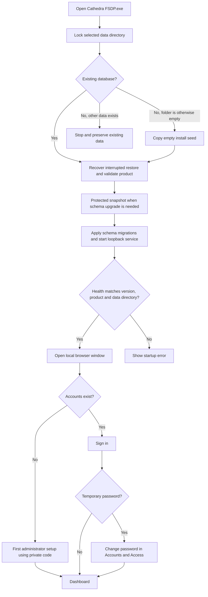
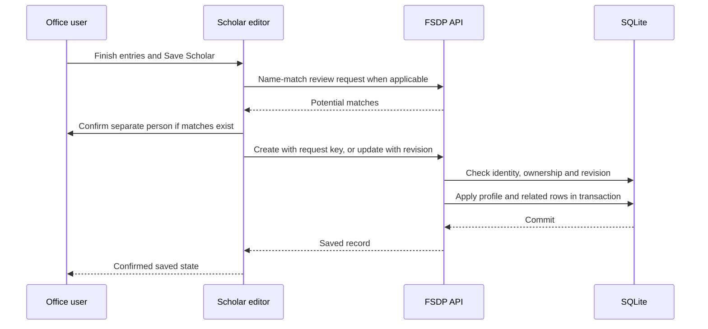

# Application flow

**Product:** Cathedra FSDP  
**Documented:** 25 October 2026, Asia/Manila 
**Baseline:** release 0.5.25; database schema 16 
**Status:** implementation-derived documentation; see [baseline and evidence](README.md).

## Navigation map

| Page | Route | Main purpose |
|---|---|---|
| Sign in / first setup | `/login` | Access an existing local account or create the first administrator with the private setup token. |
| Dashboard | `/` | Overview, ten recent scholars, requirement follow-up, contract assessment and embedded reports. |
| Scholar directory | `/fsdp` | Search, current-status/completeness filters, paginated results and profile links. |
| New scholar | `/fsdp/new` | Create a profile and its optional related entries. |
| Scholar profile | `/fsdp/:id` | Identity, profile remarks, education, requirements, annual grants and permitted history. |
| Edit scholar | `/fsdp/:id/edit` | Load the complete record and revision; edit and save it atomically. |
| Settings | `/settings` | Program catalog and existing office settings navigation. |
| Accounts & Access | `/settings/accounts` | Own password change and administrator account operations. |
| Program catalog | `/settings/programs` | Administrator catalog operations and explicit review of historical program identities. |
| Office Log | `/office-log` | Append document receipts/transfers and review or export the register. |
| Backup & Export | `/backup-export` | CSV exports, local snapshots and administrator recovery actions. |
| System Readiness | `/system-readiness` | Local operating and recovery status. |
| Activity History | `/activity` | Administrator event review. |
| Office Guide | `/office-guide` | Searchable local product instructions. |

`/account-security` redirects to `/settings/accounts`, preserving query/hash. Unknown routes redirect to Dashboard. `/reports` is not a separate report screen. Dashboard links use `#dashboard-reports` and `#contract-assessment` to open the appropriate embedded sections.

## Startup and sign-in

Only the process owning the selected database lock may open that data directory. The launcher does not reuse an occupied port as another service. In an Edge app window, closing the window shuts down its local service. With a normal-browser fallback, use **Exit Cathedra** before closing the tab.

## Create or edit a scholar

1. Find the scholar in the directory, or choose Add scholar. Results are alphabetical by the complete stored name, ignoring case and surrounding spaces, with scholar ID breaking ties. Name search matches the start of name words; program, department, rank and HEI may also match the general search.
2. Enter Name and select the correct College / Staff. Record hard-copy and soft-copy availability independently as Available, Not available or Not recorded. These optional facts do not mark requirements complete or upload a file. Add whole-profile remarks separately from grant notes.
3. Add/edit each education item and finish that entry. Add/edit grants through their own editor. Each grant requires Program Applied; its period, type, outcome, case state, optional graduation date and remarks remain individual to that grant. Status and case controls follow the remarks near the save action.
4. **Save Grant** updates the open scholar draft, not the database. **Save Scholar** persists the profile and related lists. An open education/grant draft must be saved or cancelled before the scholar can be submitted.
5. Review similar-name warnings. Confirm separate people when appropriate; no automatic merge occurs.
6. On success, return to the scholar workflow. Existing records carry revisions; a conflict requires loading/reviewing the newer record rather than silently retrying over it.

Removing a grant or education row from the editor takes effect when the scholar is saved. Submitted grant/requirement lists replace that scholar's related collection. This is not a partial-list PATCH operation. IDs from another scholar are rejected.

New business-record text is uppercased consistently; account credentials retain their case. A recognized consecutive year range formats as YYYY-YYYY, including eight digits or common separators. A complete single four-digit year remains a single calendar year on blur or Save Grant; partial, custom and nonconsecutive optional values stay editable and saveable. Age and tenure can be typed normally without accidental mouse-wheel changes. Icon-only profile/education/grant controls retain named tooltips and keyboard access.

### Save and recovery sequence

If a create response is uncertain, keep the original draft/request key and retry **Save Scholar** with the original account. The API either confirms that create or rejects a changed payload; it does not create another scholar for the same key. Do not start a new record solely because a response was lost.

If the session expires, the interface pauses editing and asks the same account to sign in again. The draft stays in memory, and no save is sent automatically. Refreshing/closing still loses an unsaved draft. Directory filter/page/scroll preferences are session-scoped; they are not saved scholar data.

## Annual grant and program duplication

Administrators choose Copy for next year in the scholar editor. It opens a new draft with separate identity, On Going outcome, Open case state and cleared actual dates, including contract completion and graduation. Update the copied academic year/terms and other applicable details, Save Grant, then Save Scholar. Recognized academic-year ranges advance by one; terms stay as recorded. Remarks are retained for review, while extension is cleared; review copied remarks for their new annual context. The privileged persisted-grant duplication endpoint is separate from this draft-copy interaction.

Annual copying preserves the selected program ID, including when older catalog names are equivalent. Administrators manage and duplicate programs in Settings → Programs. Catalog duplication creates a separate program immediately with a unique Copy suffix; it does not duplicate a scholar or all their grants. Use New application for another enrollment under the existing program. Unsaved scholar drafts and in-flight catalog mutations retain their respective navigation guards.

The grant editor uses one Program Applied field; it resolves the catalog identity without a separate Existing program field. Select Degree, Certification or Enhancement as an optional Program category independently of Type of Grant. For another academic year within an existing application, use Copy for next year. For a separate later enrollment in the same program, use New application; it receives a new application identity, clears remarks/outcome/actual dates and proposes the next period after the previous end year. Review the proposed period before saving. The Application control can associate existing annual records with the intended application. The editor and profile stack records under that application and show its overall term/year span.

Existing grants with an unrecorded application identity remain together under their original program. The upgrade does not guess enrollment boundaries or split historical grants. Assign applications only after reviewing office evidence. Completion clears calculated follow-up only within the same explicit application; unassigned older records retain the former same-program rule. Recorded repayment outcomes remain explicit office decisions.

Completed replaces Graduated as the displayed recorded outcome. It can add the program to the scholar's education even without recognizable remarks; optional graduation date supplies a year only where manual education intent permits. Opening or closing a case does not change its outcome. Collapse the whole grant history or expand the program/year needed; prepared profile printing includes all history.

## Record document receipts and transfers

Open Office Log, enter the document/event details and optionally link a scholar. Record the date and from/to department when known, then save the log entry. A submission is an immediate log operation, separate from Save Scholar. The authenticated author and linked scholar name are captured for the register. Entries are append-only; use a subsequent explanatory entry to record a correction rather than silently changing the historical entry. Filter/page the register for review; CSV covers the complete selected scope. Uploaded document files are not stored.

After a confirmed save the log editor closes, focus returns to Add log entry and search/type filters reset to the first page. The register keeps event-date order, so backdated entries can appear on later pages. Each compact entry shows its date/type and available document/scholar context; expand it for notes, departments and author. Failed or uncertain saves keep the original draft open for a safe retry. Printing expands all entries on the loaded page and restores their previous disclosure states afterward; it does not load other pages.

## Dashboard, reports and contract review

Choose College / Staff and starting academic year to set the overview scope. Use chart order for presentation. The latest ten scholars in that scope link to their profiles. Open Dashboard reports for additional report filters, result pages, complete filtered CSV or printable views.

Directory, Dashboard detail and payback CSVs keep each scholar's grants together. The first row shows the scholar's profile and first grant; subsequent rows leave profile cells blank and show the remaining grants. Read those rows as belonging to the preceding named scholar. Keep each complete scholar group together when rearranging the spreadsheet. Every grant retains its individual period, contract/graduation dates, outcome, case and remarks. Source/provenance columns are absent from directory and education exports.

For contract assessment, open the detail disclosure and choose a category. Payback pending contract, Recorded Payback and calculated Payback review are separate. Pending contract is manually recorded while repayment arrangements are being completed; final Payback is an office decision after the contract. Follow a scholar link, verify completion/graduation facts, then edit the relevant grant if an outcome correction is justified. The calculation never makes that correction itself.

Tables normally display a bounded page. Cathedra's Print buttons prepare a separate complete snapshot of the selected result, including the Dashboard overview and selected report/contract scope where applicable; CSV also covers the complete selected result. Changing filters or leaving the page cancels pending preparation. Browser Ctrl+P prints the currently loaded view and is labelled accordingly; use Cathedra's Print action for all matching records. The status doughnut and grant pie have labelled counts/percentages; guidance about the definitions belongs in the Office Guide.

## Backup and restore

Administrators create a local database snapshot, optionally protect it against deletion, download/copy it to private storage and record an off-device/restore review only after actually completing those actions. A seven-day reminder means a snapshot is due; it is not proof of off-device recovery.

Restore selects an available compatible FSDP snapshot and confirms the operation. The service gates concurrent record work, stages and validates the snapshot, retains a safety backup, preserves the scholar ID high-water and revokes sessions. Sign in again after success. If interrupted recovery cannot complete, record operations stay blocked until a successful restart recovers the protected copy.

## Transfer and update an Office installation

```mermaid
flowchart LR
    A[Verified update package without live data] --> B[Transfer to Office PC]
    B --> C[Close existing Office app]
    C --> D[Run updater against existing installation]
    D --> E[Lock data, snapshot and rehearse on a copy]
    E --> F[Replace runtime and preserve actual database]
    F --> G[Open app from original installation folder]
    G --> H[Protected migration at startup if needed]
    H --> I[Verify Office records and workflows]
```

Copying an update folder is only transfer. Starting its EXE directly can create a new empty data directory alongside that EXE. To update, use `tools/update-office.ps1` with `-Installation` set to the existing Office app folder and `-Package` set to the transferred update. Keep the actual Office `data` directory in place; never replace it with the development database. If moving to a completely new PC, use a separate verified backup/restore or closed-installation migration procedure.

Sources: [frontend routes](../../frontend/src/App.tsx), [scholar editor](../../frontend/src/pages/FsdpFormPage.tsx), [session recovery](../../frontend/src/components/SessionRecovery.tsx), [desktop launcher](../../desktop/run_cathedra.py), [Office updater](../../desktop/office_update.py), [maintenance API](../../backend/app/api/maintenance.py).

## Evidence and assessment checks in 0.5.15

Review graduation remarks as evidence about the current program; previous degrees or another person’s graduation must not create a current achievement. Unsupported or ambiguous wording stays saveable. Confirm outcomes explicitly: inferred education does not change the grant’s status. Existing automatic achievements are retained for individual review and correction/removal. Summer remains selectable.

Payback category selection is consistent in complete CSV, paged and unpaged results. Category cards describe the entire department/year scope; the selected table total describes its filtered records. Staff may create a missing program name while saving a scholar; direct catalog management remains privileged.

## Completion and reporting update (0.5.22)

Calendar years stay literal: 2021 remains 2021; 2021-2022 remains an explicit academic-year range. Uppercase record controls preserve cursor/selection and multiline composition. Incomplete is an additional known grant outcome. The optional program start date and whole allowed duration produce a completion deadline; an explicit optional deadline takes priority, including for shorter programs. Previous completion dates remain a fallback. Grace runs three calendar years from the effective deadline, including its final day. Repayment progress (Not recorded, Unpaid, Partially paid, Fully paid) is separate from outcome and case status.

The administrator can configure and connect Google reporting from Backup & Export, then explicitly confirm a one-way replacement of the CATHEDRA REPORT tab. Other tabs are preserved. Connection credentials are Windows-user encrypted outside SQLite. Internet and OAuth setup are needed for cloud delivery; offline records work independently. See [setup](../GOOGLE_SHEETS_SETUP.md) and [validation](../VALIDATION_0.5.22.md).

Annual copies in the same application retain an explicitly recorded program start/duration/deadline rule, so another funding year does not move that program deadline. Payment progress, graduation, previous completion dates, end dates and outcome are reset for review. When no new program completion rule is recorded, the former actual-start clearing behavior is retained. New application clears program start, duration, deadline and payment progress; existing historical records are never mass-rewritten.

## Google report update (0.5.23)

Google reporting uses a dedicated [fifteen-column contract](GOOGLE_REPORT_CONTRACT.json) rather than the full CSV table. Each scholar is numbered once and their grants remain on consecutive rows. The report retains recorded education, tenure in years, exact dates or recorded academic periods, each grant's outcome and clearly labeled profile/grant remarks. Existing CSV exports and schema16 are unchanged. Setup, approved test accounts, spreadsheet editing access and per-PC sign-in are described in the [detailed guide](../GOOGLE_SHEETS_SETUP.md). See [0.5.23 validation](../VALIDATION_0.5.23.md) for observed delivery status.

## Paper & Ink integration (0.5.24)

The production UI uses the new Scholar Office shell and visual system. Scholar entry is organized into identity, education, programs/grants and review steps over the existing atomic aggregate save. Reports remain on the dashboard, with an additive real registration-history series and accessible chart data. Role, session, revision, idempotency, business and recovery contracts remain in force. Schema16 and existing CSV/Google report formats are retained. See the [implementation plan](../plans/2026-10-24-paper-office.md), [current design brief](DESIGN_BRIEF.md) and [versioned validation](../VALIDATION_0.5.24.md) for implementation and observed gates.

## Profile reading refinement (0.5.25)

From a scholar profile, choose Education or Programs & grants to read those records at the full content width. Education opens with its qualification details visible; each entry still supports keyboard disclosure. Program applications continue to group their annual grants, and the existing status, deadline, repayment and remarks fields remain available. Supporting profile information remains reachable, and printing continues to include the record sections. Editing and saving still use the same complete scholar draft and final Save Scholar action.

The Overview status chart also has a larger plot and clearer legend. These layout changes follow the [readability plan](../plans/2026-10-25-profile-readability.md); see [0.5.25 validation](../VALIDATION_0.5.25.md) for current verification progress.
