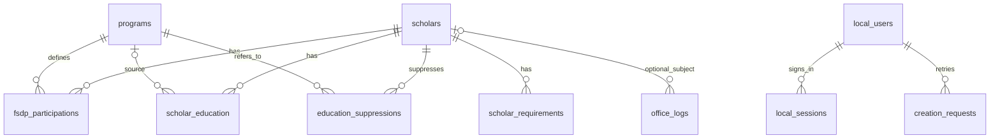

# Backend schema and data dictionary

**Product:** Cathedra FSDP  
**Documented:** 14 October 2026, Asia/Manila 
**Baseline:** release 0.5.19; database schema 13 
**Status:** implementation-derived documentation; see [baseline and evidence](README.md).

## Database baseline

Persistence is SQLite through SQLAlchemy 2. The dictionary describes models and migrations through version 13, not a production dump. A disposable in-memory database initialized through models, product binding and migrations contains 15 application/infrastructure tables and 112 columns. No live database is inspected for documentation. SQLite may additionally maintain `sqlite_sequence` in compatible historical files; that internal table is permitted by the product guard.

The default backend path is the project's `data/cathedra.db` unless `CATHEDRA_DATA_DIR` is set. The packaged launcher selects the data directory adjacent to its executable or the explicit `--data-dir`. Software release version and applied schema version are separate facts.

## Relationships

Activity rows and creation-request scholar IDs carry logical references without FK enforcement, as explained below. Backup reviews use snapshot filenames/hashes rather than a database backup table. Product marker, migration ledger and ID counter are singleton/administrative tables.

## Field dictionary conventions

`PK` gives the position in a primary key; 0 means the column is not part of it. “Nullable” treats PK columns as required, even where SQLite PRAGMA reports an INTEGER PRIMARY KEY differently. SQL defaults shown are actual defaults of the inspected schema. A dash means no SQL default; ORM/application code can still supply values such as timestamps, false flags and initial status.

SQLite declared `VARCHAR(n)` widths do not themselves enforce text length. Nullable/type/relationship checks do not mean every optional field must be filled. Business identifier requirements and typed API fields are defined in `schemas.py`; there are no database enum CHECKs for every status/grant label. ORM delete-orphan behavior and FK ON DELETE actions are different and must not be conflated.

## `scholars`

Root scholar profile. Name is indexed but not unique; revision supports optimistic writes. Profile remarks are distinct from grant remarks. Department is the canonical college/Staff/Unknown label; personnel is derived as Faculty/Staff/Unknown. Tenure text is retained for compatibility alongside numeric years/note. Missing requirements is the manual flag; returned follow-up may also derive from incomplete requirement rows.

| Column | SQLite declared type | Nullable | PK position | SQL default |
|---|---|---|---|---|
| `id` | `INTEGER` | No | 1 | — |
| `revision` | `INTEGER` | No | 0 | '0' |
| `name` | `VARCHAR(200)` | No | 0 | — |
| `age` | `INTEGER` | Yes | 0 | — |
| `previous_degree` | `VARCHAR(300)` | Yes | 0 | — |
| `missing_requirements` | `BOOLEAN` | No | 0 | — |
| `department` | `VARCHAR(120)` | Yes | 0 | — |
| `personnel_type` | `VARCHAR(20)` | Yes | 0 | — |
| `rank` | `VARCHAR(120)` | Yes | 0 | — |
| `tenure` | `VARCHAR(120)` | Yes | 0 | — |
| `tenure_years` | `FLOAT` | Yes | 0 | — |
| `tenure_note` | `TEXT` | Yes | 0 | — |
| `profile_remarks` | `TEXT` | Yes | 0 | — |
| `data_source` | `VARCHAR(30)` | No | 0 | — |
| `created_at` | `DATETIME` | No | 0 | — |
| `updated_at` | `DATETIME` | No | 0 | — |

Indexes: `ix_scholars_department`; `ix_scholars_name`.

## `programs`

Shared academic program catalog with revision, raw-name uniqueness and a Unicode canonical identity key. A catalog copy gets a new identity. Grant attribution uses its own delivering HEI; the catalog institution is not silently substituted in reporting. Historical equivalent-name groups retain their names, IDs and grant references with null canonical keys; users must select an explicit identity rather than silently merging them.

| Column | SQLite declared type | Nullable | PK position | SQL default |
|---|---|---|---|---|
| `id` | `INTEGER` | No | 1 | — |
| `revision` | `INTEGER` | No | 0 | '0' |
| `name` | `VARCHAR(300)` | No | 0 | — |
| `canonical_key` | `TEXT` | Yes | 0 | — |
| `delivering_hei` | `VARCHAR(200)` | Yes | 0 | — |
| `description` | `TEXT` | Yes | 0 | — |

Indexes: `ix_programs_name` (unique); `uq_programs_canonical_key` (unique for non-null keys). Canonicalization uses Unicode NFKC, casefolding and normalized whitespace. Catalog responses expose `identity_conflict` for explicit review; that value is derived, not a stored column.

## `fsdp_participations`

Individual annual grant/participation. Several rows may share scholar/program. Status and grant type are recorded strings, including retained custom values. Completed is the canonical former Graduated outcome. Case status is independently Open/Closed. Start/end date columns are optional compatibility data; actual contract completion starts grace assessment, and optional graduation date supplies a separate graduation fact. Annual copying clears all actual dates and starts On Going/Open.

| Column | SQLite declared type | Nullable | PK position | SQL default |
|---|---|---|---|---|
| `id` | `INTEGER` | No | 1 | — |
| `scholar_id` | `INTEGER` | No | 0 | — |
| `program_id` | `INTEGER` | No | 0 | — |
| `delivering_hei` | `VARCHAR(200)` | Yes | 0 | — |
| `start_date` | `DATE` | Yes | 0 | — |
| `end_date` | `DATE` | Yes | 0 | — |
| `contract_completed_on` | `DATE` | Yes | 0 | — |
| `graduation_date` | `DATE` | Yes | 0 | — |
| `case_status` | `VARCHAR(20)` | No | 0 | 'Open' |
| `start_term` | `VARCHAR(50)` | Yes | 0 | — |
| `start_academic_year` | `VARCHAR(20)` | Yes | 0 | — |
| `end_term` | `VARCHAR(50)` | Yes | 0 | — |
| `end_academic_year` | `VARCHAR(20)` | Yes | 0 | — |
| `status` | `VARCHAR(50)` | No | 0 | — |
| `grant_type` | `VARCHAR(100)` | Yes | 0 | — |
| `grant_other` | `VARCHAR(200)` | Yes | 0 | — |
| `extension` | `VARCHAR(200)` | Yes | 0 | — |
| `remarks` | `TEXT` | Yes | 0 | — |

Foreign keys:

| Column | References | ON DELETE | ON UPDATE |
|---|---|---|---|
| `program_id` | `programs.id` | NO ACTION | NO ACTION |
| `scholar_id` | `scholars.id` | NO ACTION | NO ACTION |

Indexes: `ix_fsdp_participations_scholar_id`; `ix_fsdp_participations_program_id`; `ix_fsdp_participations_status`; `ix_fsdp_participations_status_scholar`.

## `scholar_education`

Multiple education achievements per scholar. Optional source_program_id marks an automatically generated achievement and uses database SET NULL when the program is deleted. Level/degree/institution can be empty. Completed program status can create an achievement without recognizable remarks, while an associated graduation date or clear evidence can supply a year. Manual years, explicit clears and removal suppression remain authoritative.

| Column | SQLite declared type | Nullable | PK position | SQL default |
|---|---|---|---|---|
| `id` | `INTEGER` | No | 1 | — |
| `scholar_id` | `INTEGER` | No | 0 | — |
| `source_program_id` | `INTEGER` | Yes | 0 | — |
| `level` | `TEXT` | No | 0 | — |
| `degree` | `TEXT` | No | 0 | — |
| `institution` | `TEXT` | No | 0 | — |
| `graduation_year` | `TEXT` | Yes | 0 | — |
| `graduation_year_manual` | `BOOLEAN` | No | 0 | 0 |

Foreign keys:

| Column | References | ON DELETE | ON UPDATE |
|---|---|---|---|
| `source_program_id` | `programs.id` | SET NULL | NO ACTION |
| `scholar_id` | `scholars.id` | NO ACTION | NO ACTION |

Indexes: `ix_scholar_education_scholar_id`.

## `scholar_requirements`

Individual requirements with optional due date, completion state, completion timestamp and remarks. Incomplete rows contribute to the scholar follow-up flag. Completion transitions set or clear the timestamp in application logic.

| Column | SQLite declared type | Nullable | PK position | SQL default |
|---|---|---|---|---|
| `id` | `INTEGER` | No | 1 | — |
| `scholar_id` | `INTEGER` | No | 0 | — |
| `requirement_name` | `VARCHAR(200)` | No | 0 | — |
| `due_date` | `DATE` | Yes | 0 | — |
| `is_complete` | `BOOLEAN` | No | 0 | — |
| `completed_at` | `DATETIME` | Yes | 0 | — |
| `remarks` | `VARCHAR(500)` | Yes | 0 | — |

Foreign keys:

| Column | References | ON DELETE | ON UPDATE |
|---|---|---|---|
| `scholar_id` | `scholars.id` | NO ACTION | NO ACTION |

Indexes: `ix_scholar_requirements_scholar_id`; `ix_scholar_requirements_due_complete`.

## `education_suppressions`

Composite scholar/program identity records an explicit removal of generated education. No additional row ID is needed. Both database foreign keys use CASCADE.

| Column | SQLite declared type | Nullable | PK position | SQL default |
|---|---|---|---|---|
| `scholar_id` | `INTEGER` | No | 1 | — |
| `program_id` | `INTEGER` | No | 2 | — |

Foreign keys:

| Column | References | ON DELETE | ON UPDATE |
|---|---|---|---|
| `program_id` | `programs.id` | CASCADE | NO ACTION |
| `scholar_id` | `scholars.id` | CASCADE | NO ACTION |

Indexes: `sqlite_autoindex_education_suppressions_1` (unique).

## `creation_requests`

Composite user/request key makes creates retry-safe. Digest binds the key to the original payload. scholar_id deliberately has no FK so a deleted scholar identity cannot be recreated by retrying the same request; user FK uses CASCADE.

| Column | SQLite declared type | Nullable | PK position | SQL default |
|---|---|---|---|---|
| `user_id` | `INTEGER` | No | 1 | — |
| `request_key` | `VARCHAR(64)` | No | 2 | — |
| `payload_digest` | `VARCHAR(64)` | No | 0 | — |
| `scholar_id` | `INTEGER` | No | 0 | — |
| `created_at` | `DATETIME` | No | 0 | — |

Foreign keys:

| Column | References | ON DELETE | ON UPDATE |
|---|---|---|---|
| `user_id` | `local_users.id` | CASCADE | NO ACTION |

Indexes: `sqlite_autoindex_creation_requests_1` (unique).

## `local_users`

Local accounts. Exact and lower(username) uniqueness protect identity. Role is enforced in API logic; active and temporary-password flags affect every authenticated request. No plaintext password is stored.

| Column | SQLite declared type | Nullable | PK position | SQL default |
|---|---|---|---|---|
| `id` | `INTEGER` | No | 1 | — |
| `username` | `VARCHAR(80)` | No | 0 | — |
| `password_hash` | `VARCHAR(255)` | No | 0 | — |
| `role` | `VARCHAR(20)` | No | 0 | — |
| `is_active` | `BOOLEAN` | No | 0 | '1' |
| `must_change_password` | `BOOLEAN` | No | 0 | '0' |
| `created_at` | `DATETIME` | No | 0 | — |

Indexes: `uq_local_users_username_lower` (unique); `ix_local_users_username` (unique).

## `office_logs`

Append-only operational register for general notes, document receipts and transfers. Optional scholar FK uses SET NULL when a scholar is deleted; the captured name remains. Actor identity is server-assigned and deliberately not a local-user FK, so history survives account deletion. `request_key` and `payload_digest` support an optional UUID Idempotency-Key scoped to the author; retrying the same immutable payload returns the original entry, and changed payload conflicts. Read responses omit request metadata. No edit/delete routes or document-file storage are provided.

| Column | SQLite declared type | Nullable | PK position | SQL default |
|---|---|---|---|---|
| `id` | `INTEGER` | No | 1 | — |
| `scholar_id` | `INTEGER` | Yes | 0 | — |
| `scholar_name` | `TEXT` | Yes | 0 | — |
| `user_id` | `INTEGER` | No | 0 | — |
| `username` | `VARCHAR(80)` | No | 0 | — |
| `request_key` | `VARCHAR(64)` | Yes | 0 | — |
| `payload_digest` | `VARCHAR(64)` | Yes | 0 | — |
| `occurred_on` | `DATE` | No | 0 | — |
| `created_at` | `DATETIME` | No | 0 | — |
| `entry_type` | `VARCHAR(40)` | No | 0 | — |
| `note` | `TEXT` | No | 0 | — |
| `document_name` | `TEXT` | Yes | 0 | — |
| `from_department` | `TEXT` | Yes | 0 | — |
| `to_department` | `TEXT` | Yes | 0 | — |

Foreign key: `scholar_id` → `scholars.id`, ON DELETE SET NULL, ON UPDATE NO ACTION. Indexes: `ix_office_logs_scholar_id`; `ix_office_logs_occurred_id` (`occurred_on`, `id`); unique `uq_office_logs_user_request` (`user_id`, `request_key`). An omitted event date uses the application's current date; `created_at` records server creation time. These application defaults are not SQL defaults. Event type uses canonical Note / Document received / Document transferred labels; newly submitted note/document/department text is uppercase, while actor and scholar snapshots retain their recorded identity.

## `local_sessions`

Bearer session digest, user ID and UTC-naive expiry time. Raw tokens are never stored here. Expired sessions are pruned when sessions are created; account controls revoke sessions explicitly.

| Column | SQLite declared type | Nullable | PK position | SQL default |
|---|---|---|---|---|
| `id` | `INTEGER` | No | 1 | — |
| `user_id` | `INTEGER` | No | 0 | — |
| `token_hash` | `VARCHAR(128)` | No | 0 | — |
| `expires_at` | `DATETIME` | No | 0 | — |

Foreign keys:

| Column | References | ON DELETE | ON UPDATE |
|---|---|---|---|
| `user_id` | `local_users.id` | NO ACTION | NO ACTION |

Indexes: `ix_local_sessions_user_id`; `ix_local_sessions_token_hash` (unique); `ix_local_sessions_expires_at`.

## `activity_events`

Change/event ledger. User and subject scholar IDs are intentionally not database FKs so history can outlive deleted accounts/records. changed_fields contains JSON field names, not a promised complete before/after value snapshot.

| Column | SQLite declared type | Nullable | PK position | SQL default |
|---|---|---|---|---|
| `id` | `INTEGER` | No | 1 | — |
| `user_id` | `INTEGER` | Yes | 0 | — |
| `username` | `VARCHAR(80)` | Yes | 0 | — |
| `action` | `VARCHAR(160)` | No | 0 | — |
| `area` | `VARCHAR(80)` | No | 0 | — |
| `record_type` | `VARCHAR(80)` | Yes | 0 | — |
| `record_id` | `INTEGER` | Yes | 0 | — |
| `operation` | `VARCHAR(40)` | Yes | 0 | — |
| `changed_fields` | `TEXT` | Yes | 0 | — |
| `subject_scholar_id` | `INTEGER` | Yes | 0 | — |
| `created_at` | `DATETIME` | No | 0 | — |

Indexes: `ix_activity_events_created_id`; `ix_activity_events_user_id`; `ix_activity_events_created_at`; `ix_activity_events_subject_scholar_id`.

## `backup_reviews`

Recovery-review attestation with snapshot filename/hash, reviewer, copied-off-device and restore-tested flags. Review reflects what an administrator records; it is not automatic proof of external storage or restore completion.

| Column | SQLite declared type | Nullable | PK position | SQL default |
|---|---|---|---|---|
| `id` | `INTEGER` | No | 1 | — |
| `filename` | `VARCHAR(200)` | No | 0 | — |
| `backup_sha256` | `VARCHAR(64)` | No | 0 | — |
| `username` | `VARCHAR(80)` | No | 0 | — |
| `copied_off_device` | `BOOLEAN` | No | 0 | — |
| `restore_tested` | `BOOLEAN` | No | 0 | — |
| `reviewed_at` | `DATETIME` | No | 0 | — |

## `cathedra_product`

Infrastructure singleton id=1 identifies product fsdp; a CHECK restricts the singleton ID. Nonmatching/combined databases are rejected.

| Column | SQLite declared type | Nullable | PK position | SQL default |
|---|---|---|---|---|
| `id` | `INTEGER` | No | 1 | — |
| `product` | `TEXT` | No | 0 | — |

## `schema_migrations`

Ordered migration ledger: version PK, migration name and application timestamp. The application validates a contiguous known history; no Alembic version table is used.

| Column | SQLite declared type | Nullable | PK position | SQL default |
|---|---|---|---|---|
| `version` | `INTEGER` | No | 1 | — |
| `name` | `VARCHAR(100)` | No | 0 | — |
| `applied_at` | `DATETIME` | No | 0 | CURRENT_TIMESTAMP |

## `scholar_id_counter`

Infrastructure singleton id=1 with nonnegative high_water CHECK. Allocation and the track_scholar_identity insert trigger preserve the highest identity; restore carries forward the newer floor.

| Column | SQLite declared type | Nullable | PK position | SQL default |
|---|---|---|---|---|
| `id` | `INTEGER` | No | 1 | — |
| `high_water` | `INTEGER` | No | 0 | — |
## Integrity and deletion semantics

- Foreign keys are enabled on SQLite connections. The app also checks record ownership before applying submitted grant/requirement/education IDs.
- Scholar relationships to grants, education, requirements and education suppressions use ORM `all, delete-orphan`. Deleting through the application removes these related rows as part of the operation; direct SQL deletion must respect the actual FK actions above.
- A program with participation history cannot be deleted by the API. Program identity uses Unicode NFKC, case folding and normalized whitespace. The unique canonical-key index enforces the same identity rule for new writes, including concurrent creation. Historical equivalent-name groups retain their IDs, names and grants with null keys; an ambiguous name requires an explicitly selected program ID.
- Local usernames have exact unique indexing and an explicit unique lower(username) index. Same-name scholars remain allowed.
- Scholar/program revisions start at zero and advance on the applicable write. Program updates also advance the revisions of participating scholars to invalidate stale editor snapshots.
- `creation_requests` uses UUID request keys scoped to user IDs and SHA-256 payload digests. It persists the original scholar ID after deletion and rejects a replay whose payload differs.
- `scholar_id_counter` allocation is transactional. The `track_scholar_identity` trigger updates its high-water on insertion; protected restore does not lower the known identity floor.

## Domain-derived fields

API response values such as `current_status`, `manual_requirements_follow_up`, `payback_attention`, `grace_ends_on` and `suppressed_education_program_ids` are calculated/assembled from stored rows; they are not extra columns in `scholars`. Latest grant is ordered by the starting academic year's initial four-digit year, then current term order, then grant ID. Current term order is 1st, 2nd, 3rd, Summer, as retained by the owner.

Contract review uses actual completion plus three calendar years, retaining recorded Payback and Payback pending contract precedence and clearing calculated follow-up for a Completed record in the same scholar/program. Graduated is a compatible legacy input. Case closure does not override outcome-based assessment, and the calculation does not persist an automatic Payback outcome. Tenure conversion uses recorded years plus months/12. Inference checks at most 128 source characters with bounded token scanning; longer or unconvertible text remains available as the original tenure/note rather than being rejected or truncated.

An explicit edit or clear of a generated education entry's graduation year sets `graduation_year_manual`, preventing later remark inference from restoring or replacing that choice. Historical blank years lack edit-intent evidence and retain the established inference behavior until explicitly edited. This marker is not an additional required user field.

## Migration ledger

| Version | Recorded migration name |
|---|---|
| 1 | `fsdp-only-baseline` |
| 2 | `participation-institution-attribution` |
| 3 | `scholar-history-and-backup-reviews` |
| 4 | `non-reusable-scholar-ids-and-unique-usernames` |
| 5 | `separate-scholars-with-identical-names` |
| 6 | `education-tenure-terms-and-dashboard` |
| 7 | `optional-contract-completion` |
| 8 | `explicit-personnel-and-graduated-education` |
| 9 | `safe-writes-and-education-removal` |
| 10 | `profile-remarks-and-college-classification` |
| 11 | `graduation-evidence-and-automatic-personnel` |
| 12 | `unicode-program-identity-and-education-edit-intent` |
| 13 | `completed-outcomes-case-status-and-office-logs` |
Migration 6 establishes education/tenure/term handling and removes active `fsdp_records` and `fsdp_legacy_fields` tables plus legacy grant-standardization columns. Migration 7 adds optional actual contract completion. Migration 8 adds explicit personnel/source-program education support. Migration 9 adds program revisions, creation request keys and education-removal persistence. Migration 10 adds profile remarks and canonicalizes affiliations while preserving former labels in remarks. Migration 11 derives Faculty/Staff/Unknown and backfills graduation evidence into education; changed scholar revisions advance. It does not change grant outcomes or replace manual education corrections/suppressions.

Migration 12 adds canonical program keys and explicit education-year edit intent. It preserves program names, program/grant/scholar IDs and existing education; equivalent historical identities are flagged for explicit selection rather than merged. Historical migrations initialize additive columns before using current ORM models so populated older FSDP versions can upgrade safely.

Migration 13 adds optional graduation date, independent Open/Closed case status and the append-only Office Log. Existing Graduated outcomes become Completed, existing grants start Open, and affected profile revisions advance. It does not mass-uppercase historical text, reset credentials, merge program identities or reinterpret Summer. Compatible earlier model migrations initialize the additive grant fields before operating on current models.

The migration runner validates known contiguous versions/names and applies each migration once. The startup upgrade wrapper reserves a SQLite write, verifies product identity, creates an integrity-checked protected snapshot when an existing database needs upgrading, applies migrations transactionally and checks foreign keys before commit. Failure aborts the change rather than proceeding with a partially trusted database.

## Data boundaries and exports

Profile remarks and grant remarks are separate text fields and separate CSV columns. Education has its own CSV. Actual CSV schemas/escaping are maintained in the [export reference](../EXPORT_SCHEMAS.md); data dictionary columns are not a claim that every export includes every technical field. CSV formula-leading strings are escaped through the safe writer.

No workload/projection/Needs Verification tables are part of the current allowlisted schema. Compatible earlier FSDP backups may require migration; original combined or other-product data requires offline verified conversion and cannot be restored directly as current FSDP data.

Files outside the database, including protected snapshot pins, restore/update receipts, runtime archives, diagnostics and the maintenance JSONL journal, are not missing relational tables. Keep them with their documented recovery procedures.

Sources: [models](../../backend/app/models.py), [database connection](../../backend/app/db.py), [API schemas](../../backend/app/schemas.py), [migrations](../../backend/app/migrations.py), [product guard](../../backend/app/product.py), [upgrade wrapper](../../backend/app/upgrade.py), [identity allocation](../../backend/app/scholar_identity.py), [FSDP mutations](../../backend/app/api/fsdp.py).
