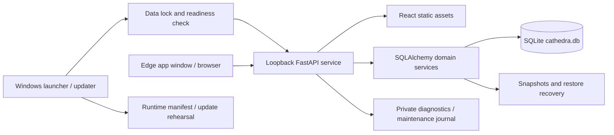

# Technical requirements

**Product:** Cathedra FSDP  
**Documented:** 25 October 2026, Asia/Manila 
**Baseline:** release 0.5.25; database schema 16 
**Status:** implementation-derived documentation; see [baseline and evidence](README.md).

## Architecture and deployment

Cathedra FSDP is a packaged local web application. A Windows executable starts Uvicorn/FastAPI on loopback, serves the built React application and accesses one file-backed SQLite database through SQLAlchemy. The browser is the UI, not the database owner. The packaged runtime includes Python and frontend assets; the Office PC does not need a separate Python/Node installation.

## Stack and source layout

| Layer | Current implementation |
|---|---|
| Frontend | React 19, TypeScript, React Router 7, Vite 7, plain CSS, SVG analytics |
| Browser tests | Vitest, Testing Library, jsdom, axe-core |
| Backend | Python, FastAPI, Pydantic 2, SQLAlchemy 2, Uvicorn, SQLite |
| Backend tests/static checks | pytest, HTTPX, Ruff; branch coverage quality tooling |
| Desktop release | PyInstaller one-directory executable; PowerShell build/verify/update wrappers |
| Release build environment | Required build baseline: Windows x64, Python 3.14.7 and Node v26.8.1; PowerShell 7 for packaging |

Exact package versions come from `frontend/package-lock.json` and `backend/constraints-win-py314.txt`; broad dependency ranges in package/requirements files are not reproducible-build evidence by themselves.

`frontend/src/pages` contains screens; `components` contains shared controls/charts; `api` contains request adapters; `hooks` contains local interaction state. `backend/app/api` contains routes; domain services implement rules; `models.py`, `schemas.py`, `migrations.py` and `upgrade.py` define persistence/validation/evolution. `desktop` contains launch, packaging, maintenance checks and update mechanics. `tools` provides operational verification/export/dependency scripts. Existing `data` belongs to the selected installation and is outside distributable source/runtime payloads.

## Functional and integrity requirements

| ID | Implemented requirement | Primary enforcement |
|---|---|---|
| TR-01 | Local service ownership | Data-directory lock; free-port check; matching product/version/data-directory health before opening browser |
| TR-02 | Correct product/database | `fsdp` product marker and schema/table allowlist; incompatible/combined backups rejected |
| TR-03 | Atomic record changes | Related records applied in transaction; foreign IDs/duplicate related IDs rejected |
| TR-04 | Optimistic concurrency | Integer `If-Match` for scholar update/delete and persisted grant duplicate, plus program update; missing revision 428, stale revision 409 |
| TR-05 | Safe create retries | UUID `Idempotency-Key`, account-scoped composite key and canonical payload digest; changed payload or deleted original produces conflict |
| TR-06 | Lightweight business fields | Scholar Name and each grant's Program Applied required; optional profile/grant details retained; typed dates, finite nonnegative tenure and relationship checks remain |
| TR-07 | Non-reusable scholar identity | Counter/high-water trigger and restore floor; identical names allowed |
| TR-08 | Durable education choices | Generated education links to program; removal suppression survives later saves; explicit restoration supported |
| TR-09 | Complete reporting | Server scope/pagination and complete CSV/print; scholar-versus-grant totals distinguished |
| TR-10 | Safe schema evolution | Ordered migrations, protected pre-migration snapshot and integrity/FK checks |
| TR-11 | Recovery gating | Restore stages/validates, retains safety copy, drains/gates active work and revokes sessions; unresolved recovery blocks record work |
| TR-12 | Data-preserving deployment | Verified package, rehearsal on a copy, runtime replacement and rollback safeguards; destination data preserved |
| TR-13 | Consistent record text | Uppercase newly submitted editable business text; retain unchanged historical identities, canonical enum labels and account credentials |
| TR-14 | Independent grant facts | Completed outcome, Open/Closed case state and optional graduation date; compatible Graduated input; date-free annual copies |
| TR-15 | Durable Office Log | Signed-in reads/export, admin/staff append, server actor/scholar snapshots, optional author-scoped UUID retry key and no update/delete routes |

Current record updates send full related lists, not PATCH fragments. Omitted compatibility fields such as profile remarks/department are handled selectively to avoid older clients wiping newer information, but clients must not assume every omitted property is universally preserved. Use the current typed payload contract. Scholar saves accept a selected `source_program_id` and use Unicode-normalized identity for typed program names. Historical equivalent-name groups require explicit selection; they are never merged automatically. A missing catalog name can still be created inside the scholar transaction, including for staff; direct catalog management remains administrator-only. Database canonical-key uniqueness protects simultaneous creates.

Generated education years retain explicit edits and clears through a stored intent marker. Tenure inference bounds source scanning while preserving longer text and notes. Prepared print snapshots are separate from normal table state and cancel when filters, navigation or underlying data change. The release build checks runtime versions and pointer width before installing dependencies, then verifies all pinned packages.

New editable business text passes a shared uppercase normalizer before persistence; unchanged historical values and selected program IDs are preserved rather than mass-renamed. The API normalizes recognized consecutive eight-digit academic years; the editor additionally formats common separators and preserves a single four-digit year on blur/Save Grant. Partial, custom, reversed or nonconsecutive ranges remain accepted; formatting is not chronology validation. Completed status can link the current program to education independently of remark parsing, with optional graduation-date year inference subordinate to durable manual intent. Case status is a per-grant Open/Closed field and never substitutes for its outcome. Annual copy preserves remarks and recorded program completion rules in the same application while clearing extension, graduation, prior completion/end dates and repayment progress.

## Authentication and access

Passwords use PBKDF2-HMAC-SHA256 with random salt and a current 600,000-iteration cost. Successful login can upgrade an older supported hash cost. Stored passwords are hashes; session tokens are random and only their SHA-256 digests are stored server-side. Sessions expire after 12 hours or 30 minutes without user activity. Protected reads do not renew inactivity; a separate activity endpoint renews an unexpired session following user input. Unfinished forms remain available after same-account reauthentication. Active-account/temporary-password checks occur per protected request.

Frontend session data is held in `sessionStorage`; the obsolete same-named `localStorage` entry is removed. Expired-user/draft recovery is in memory and requires same-account reauthentication. Disabling/resetting accounts and revoking sessions are administrator operations. Password creation/change uses a minimum ten-character constraint.

The current login limiter defaults to eight counted attempts per five-minute window, per registered normalized account or a shared unregistered bucket, and two concurrent password-verification slots. This is an in-process limiter, not a distributed internet service defense.

Protected record/export routes require sign-in. Program management/duplication, persisted grant duplication, scholar deletion, backup administration, restore, account management and activity/history require admin. Staff may create/edit scholars and their related drafts; staff is not a read-only role.

Office Log is a general operational register distinct from administrator activity history. Signed-in admin/staff read and export entries; appending also checks the editor role. The server records account identity and an optional current scholar-name snapshot. Entry text is uppercase, actor credentials remain unchanged, and deleting a scholar nulls the linked ID while retaining its snapshot. No log edit/delete endpoints or upload storage are exposed.

## HTTP contract

API base is `/api/v1`. Development frontend requests `http://127.0.0.1:8101/api/v1`; packaged requests use the same-origin relative base. JSON requests include `Authorization: Bearer <token>` where required. The first-admin setup request uses `X-Cathedra-Setup` and is only allowed before an account exists.

The health endpoint is public and reports product, release version, data-directory identity, desktop mode and recovery requirement. Desktop exit requires sign-in and is available only in desktop mode. An unknown API path returns 404 rather than the SPA index.

| Status | Current meaning |
|---|---|
| 201 / 204 | Created resource / successful operation without JSON body |
| 401 / 403 | Missing/expired/inactive session / insufficient role or required password change |
| 404 | Record, backup or API endpoint unavailable |
| 409 | Revision/name/retry/ownership conflict or operation not applicable |
| 422 | Invalid typed request/required identifier or inconsistent submitted IDs |
| 428 | Required record revision absent |
| 429 | Sign-in limit or password-verification capacity reached |
| 503 | Recovery/service gate or database temporarily unavailable |

Client request deadlines are normally 30 seconds and 180 seconds for restore. Abort/lost transport may mean an operation was not confirmed; the UI must not assume it failed before committing or automatically resubmit an arbitrary mutation.

## Endpoint and permission inventory

The table below is derived from the baseline route decorators and their authentication dependencies. All FSDP, maintenance and activity routers also receive sign-in enforcement when registered in the app. “Public / bootstrap” does not mean unrestricted first-admin setup; the private token, local-origin and empty-account checks still apply.

| Method | Endpoint | Access |
|---|---|---|
| GET | `/api/v1/health` | Public |
| POST | `/api/v1/desktop/exit` | Signed-in; desktop mode only |
| GET | `/api/v1/activity/scholars/{scholar_id}` | Administrator |
| GET | `/api/v1/activity` | Administrator |
| GET | `/api/v1/auth/status` | Public / bootstrap |
| POST | `/api/v1/auth/setup` | Public / bootstrap |
| POST | `/api/v1/auth/login` | Public / bootstrap |
| POST | `/api/v1/auth/logout` | Signed-in admin or staff |
| GET | `/api/v1/auth/me` | Signed-in admin or staff |
| GET | `/api/v1/auth/users` | Administrator |
| POST | `/api/v1/auth/users` | Administrator |
| POST | `/api/v1/auth/change-password` | Signed-in admin or staff |
| POST | `/api/v1/auth/users/{user_id}/reset-password` | Administrator |
| PUT | `/api/v1/auth/users/{user_id}/status` | Administrator |
| POST | `/api/v1/auth/users/{user_id}/revoke-sessions` | Administrator |
| GET | `/api/v1/fsdp/name-matches` | Signed-in admin or staff |
| POST | `/api/v1/fsdp/programs/{program_id}/duplicate` | Administrator |
| POST | `/api/v1/fsdp/{scholar_id}/grants/{grant_id}/duplicate` | Administrator |
| GET | `/api/v1/fsdp/programs` | Signed-in admin or staff |
| POST | `/api/v1/fsdp/programs` | Administrator |
| PUT | `/api/v1/fsdp/programs/{program_id}` | Administrator |
| DELETE | `/api/v1/fsdp/programs/{program_id}` | Administrator |
| GET | `/api/v1/fsdp` | Signed-in admin or staff |
| GET | `/api/v1/fsdp/page` | Signed-in admin or staff |
| GET | `/api/v1/fsdp/summary` | Signed-in admin or staff |
| GET | `/api/v1/fsdp/analytics` | Signed-in admin or staff |
| GET | `/api/v1/fsdp/payback` | Signed-in admin or staff |
| GET | `/api/v1/fsdp/payback.csv` | Signed-in admin or staff |
| GET | `/api/v1/fsdp/report` | Signed-in admin or staff |
| GET | `/api/v1/fsdp/report-options` | Signed-in admin or staff |
| GET | `/api/v1/fsdp/report.csv` | Signed-in admin or staff |
| GET | `/api/v1/fsdp/{scholar_id}` | Signed-in admin or staff |
| POST | `/api/v1/fsdp` | Signed-in admin or staff |
| PUT | `/api/v1/fsdp/{scholar_id}` | Signed-in admin or staff |
| DELETE | `/api/v1/fsdp/{scholar_id}` | Administrator |
| GET | `/api/v1/maintenance/status` | Signed-in admin or staff |
| POST | `/api/v1/maintenance/backups/{filename}/review` | Administrator |
| POST | `/api/v1/maintenance/backups` | Administrator |
| GET | `/api/v1/maintenance/backups/{filename}/download` | Administrator |
| DELETE | `/api/v1/maintenance/backups/{filename}` | Administrator |
| POST | `/api/v1/maintenance/backups/{filename}/protection` | Administrator |
| DELETE | `/api/v1/maintenance/backups/{filename}/protection` | Administrator |
| POST | `/api/v1/maintenance/restore` | Administrator |
| GET | `/api/v1/maintenance/exports/fsdp.csv` | Signed-in admin or staff |
| GET | `/api/v1/maintenance/exports/education.csv` | Signed-in admin or staff |
| GET | `/api/v1/office-logs` | Signed-in admin or staff |
| POST | `/api/v1/office-logs` | Signed-in admin or staff (editor role) |
| GET | `/api/v1/office-logs/export.csv` | Signed-in admin or staff |
| GET | `/api/v1/maintenance/history` | Administrator |

## Configuration and files

| Setting / flag | Purpose |
|---|---|
| `CATHEDRA_DATA_DIR` | Backend's selected writable database directory; use a disposable path for tests. The desktop launcher sets it from `--data-dir` or the executable's adjacent `data` directory. |
| `CATHEDRA_FRONTEND_DIST` | Built frontend location; launcher selects bundled assets. |
| `CATHEDRA_PRODUCT` | Must match `fsdp`; another product fails startup. |
| `CATHEDRA_RELEASE_VERSION` | Launcher supplies bundled version identity. |
| `CATHEDRA_SETUP_TOKEN` | Private first-admin bootstrap token; never commit/share a value. |
| `--port`, `--no-browser`, `--data-dir` | Launch/service controls and isolated verification. |
| `--update-target`, `--rollback-update`, `--maintenance-result` | Packaged maintenance/update mode and private result receipt. |
| `--verify-package` | Strict bundled runtime verification without selecting a data folder or opening any database; private receipt records version/count or phase/path failure details. |
| Root `VERSION`, `APP_PRODUCT`, `release-manifest.json` | Runtime identity and inventory. |
| `_internal` | Bundled runtime, built frontend, version and empty seed; retain with EXE. |
| `data/cathedra.db`, `data/backups` | Working database and local snapshots; never overwrite as a software update. |
| `data/diagnostics/operations.log` | Rotating log, 1 MiB limit per file with three backups. |
| `data/maintenance-history.jsonl` | Separate maintenance journal that survives restoring older database content. |

The system is configured through existing files/environment/launch flags; a required `.env` file is not assumed. Browser preference keys and logout warnings are not authoritative database records.

Operational prerequisites are a supported Windows environment for this packaged build, a writable local data directory, an available loopback port (8101 by default), a usable Edge/browser window and space for verified recovery copies. The migration snapshot check requires free space of at least twice the current database size plus 1 MiB; an updater/runtime archive also needs additional space. This is not a minimum RAM/disk certification for arbitrary workloads. Source development uses the matching constrained Python build environment and Node version, while the packaged Office app supplies its own runtime.

## Local security and recovery requirements

The launcher binds loopback. Trusted hosts are localhost/127.0.0.1 plus the test host; development CORS permits local frontend port 5174. Responses use `nosniff`, no-referrer and a self-origin CSP; API responses use no-store. CSP permits inline styles for current UI styling and is not documented as forbidding all inline content.

Use existing installation-access tooling and protect private snapshots/journals. Database-file permissions and device encryption are separate protections. No claim of built-in SQLite encryption, hosted HTTPS, cloud IAM, MFA or network-safe deployment is made. Keep live data, password hashes, tokens, backups and personnel exports out of repositories/public release assets.

Restore only compatible FSDP snapshots. Automatic migration runs through version 16 with a protected snapshot on older existing databases. A runtime update does not itself substitute the tested copy for the actual Office database; startup performs needed migration on the retained database. Manual backup deletion is explicit and protection-aware. Startup creates one verified daily copy; the newest 14 unpinned automatic daily copies and 30 unpinned pre-delete copies are retained. Manual and pinned copies are excluded from automatic pruning. Scholar deletion is blocked if its immediate recovery copy fails. Office Log storage is part of the compatible backup/table allowlist.

## Build, quality and release requirements

Install backend requirements with the matching constrained build file, frontend packages with the lockfile, then use `desktop/build-split-release.ps1`. Its gates verify pinned build inputs, Ruff, backend regressions, frontend test/source TypeScript checks, frontend regressions, production assets, clean seed, Windows version metadata, PyInstaller output, packaged persistence and manifest.

The separate GitHub Actions workflow also declares branch-coverage threshold 87%, moderate-or-higher dependency advisory checks, and Office smoke under built-in PowerShell and PowerShell 7. It is configured evidence, not proof that remote CI ran. Optional signing requires an organization's actual certificate; it is not automatically supplied.

Historical 0.5.14 results were 214 backend and 129 frontend tests. Current results and package checks are recorded in [0.5.19 validation](../VALIDATION_0.5.19.md); pending gates and counts are not inferred from an older release. Prior service benchmarks support local use at tested scales but do not certify end-to-end p95 or all Office devices. See the [implementation plan](IMPLEMENTATION_PLAN.md) for external acceptance and optional report-scale work.

## Change constraints

Preserve scholar IDs and annual records; keep auth enforcement in the API; maintain revision/idempotency semantics; preserve optional recorded unknowns and profile/grant remark separation. Do not add a trend chart without actual time-series data. Supported terms remain 1st/2nd/3rd/Summer. Future changes must update UI, normalization, sorting, guidance and preservation tests together.

Sources: [main service](../../backend/app/main.py), [authentication](../../backend/app/auth.py), [login limiter](../../backend/app/login_limits.py), [API client](../../frontend/src/api/client.ts), [models](../../backend/app/models.py), [concurrency](../../backend/app/concurrency.py), [launcher](../../desktop/run_cathedra.py), [build pipeline](../../desktop/build-split-release.ps1), [CI workflow](../../.github/workflows/fsdp-checks.yml).

## Evidence inference and assessment filters

Remark-derived graduation inference requires direct current-program evidence. Explicit full dates in remarks must be real and nonfuture; year-only evidence remains year-only. Ambiguous numeric dates, other-degree, historical, third-party or uncertain claims create no achievement. Recorded Completed is authoritative even when remark inference is unavailable; Graduated remains a compatible legacy input. Optional grant graduation date is separate from contract completion. Manual education and suppression survive. No optional remarks are rejected on save. Schema 12 added durable year-edit intent, retained in schema 13; existing linked entries are not bulk-deleted. A maintainer can run `tools/review_education_evidence.py SNAPSHOT --output NEW_PRIVATE_REPORT.json` against a closed disposable copy using the project Python environment. The read-only report includes IDs/reasons only; a candidate is not a deletion instruction.

Summary and department JSON retain the legacy `graduated` aggregate beside an equal `completed` value for existing consumers. Canonical status-count maps and current CSV totals use Completed only, avoiding duplicate chart categories. Directory and report-detail CSV put profile fields before annual grant fields. Profile fields are populated on each scholar's first row and blank on continuation rows; each grant keeps its own dates, status and case. Payback uses the same grouping for scholar identity cells. Directory and education exports omit source/provenance metadata. No database columns or relationships are removed. External consumers must use the current ordered [export contracts](EXPORT_CONTRACTS.json), retain group order and carry forward scholar identity when reading continuation rows.

Office Log list queries accept `scholar_id`, `search`, `entry_type`, `page` and bounded `page_size`; ordering is occurred date descending then ID descending. CSV applies the same filters without page truncation. POST can use an optional UUID `Idempotency-Key`; replay by the same author and identical normalized payload returns the original entry, changed content returns 409. A blank optional event date defaults at creation time and is included in the immutable persisted response. Request metadata is not exposed by the public read schema.

Schema 14 adds nullable scholar `has_hard_copy`/`has_soft_copy` and participation `program_category`/`application_key`, retaining all 15 existing tables and raising the model column count to 116. Copy availability uses true/false/null independently; it does not infer requirement completion. Program category is separate from funding type. Application identity is scoped to scholar and program; matching completion in a different explicit application cannot clear calculated follow-up. NULL-key history retains the original same-program scope until explicitly assigned. Older clients omitting the new optional fields preserve stored values. CSV column contracts are unchanged in 0.5.21.

Directory ordering applies Unicode casefolding and surrounding-space trimming to the complete stored name, then ID, before pagination; names are not parsed into guessed surname components. Office Log uses native disclosure rows, preserves frozen uncertain-save payloads and closes only on confirmed save. Its print handler expands/restores the loaded rows without claiming a complete multi-page register.

Payback attention filters apply to paged JSON, unpaged JSON and CSV. `total` counts selected assessment rows; `scholar_counts`/`grant_counts` remain department/year-wide category summaries. Empty attention selects all rows. Pagination bounds displayed items, not export scope.

[Export contracts](EXPORT_CONTRACTS.json) are verified against actual CSV writer output in backend tests. [Office acceptance](OFFICE_ACCEPTANCE.md) records external checks without treating development tests as Office sign-off.

## Completion and reporting update (0.5.22)

Calendar years stay literal: 2021 remains 2021; 2021-2022 remains an explicit academic-year range. Uppercase record controls preserve cursor/selection and multiline composition. Incomplete is an additional known grant outcome. The optional program start date and whole allowed duration produce a completion deadline; an explicit optional deadline takes priority, including for shorter programs. Previous completion dates remain a fallback. Grace runs three calendar years from the effective deadline, including its final day. Repayment progress (Not recorded, Unpaid, Partially paid, Fully paid) is separate from outcome and case status.

The administrator can configure and connect Google reporting from Backup & Export, then explicitly confirm a one-way replacement of the CATHEDRA REPORT tab. Other tabs are preserved. Connection credentials are Windows-user encrypted outside SQLite. Internet and OAuth setup are needed for cloud delivery; offline records work independently. See [setup](../GOOGLE_SHEETS_SETUP.md) and [validation](../VALIDATION_0.5.22.md).

Google reporting endpoints are administrator-only: `GET /api/v1/google-sheets`, `POST /api/v1/google-sheets/configure`, `POST /api/v1/google-sheets/connect`, `POST /api/v1/google-sheets/sync` (requires `replace_report: true`) and `DELETE /api/v1/google-sheets/connection`. They introduce no runtime dependency or external callback server: the existing local Python runtime performs standard OAuth authorization-code flow with PKCE and a short-lived loopback listener. Tokens are refreshed only for manual delivery. The local connection file is excluded from data snapshots and software publication; corrupt or different-Windows-user connection files can be replaced through explicit reconfiguration/forget actions.

Annual copies in the same application retain an explicitly recorded program start/duration/deadline rule, so another funding year does not move that program deadline. Payment progress, graduation, previous completion dates, end dates and outcome are reset for review. When no new program completion rule is recorded, the former actual-start clearing behavior is retained. New application clears program start, duration, deadline and payment progress; existing historical records are never mass-rewritten.

## Google report update (0.5.23)

Google reporting uses a dedicated [fifteen-column contract](GOOGLE_REPORT_CONTRACT.json) rather than the full CSV table. Each scholar is numbered once and their grants remain on consecutive rows. The report retains recorded education, tenure in years, exact dates or recorded academic periods, each grant's outcome and clearly labeled profile/grant remarks. Existing CSV exports and schema16 are unchanged. Setup, approved test accounts, spreadsheet editing access and per-PC sign-in are described in the [detailed guide](../GOOGLE_SHEETS_SETUP.md). See [0.5.23 validation](../VALIDATION_0.5.23.md) for observed delivery status.

## Paper & Ink integration (0.5.24)

The production UI uses the new Scholar Office shell and visual system. Scholar entry is organized into identity, education, programs/grants and review steps over the existing atomic aggregate save. Reports remain on the dashboard, with an additive real registration-history series and accessible chart data. Role, session, revision, idempotency, business and recovery contracts remain in force. Schema16 and existing CSV/Google report formats are retained. See the [implementation plan](../plans/2026-10-24-paper-office.md), [current design brief](DESIGN_BRIEF.md) and [versioned validation](../VALIDATION_0.5.24.md) for implementation and observed gates.
