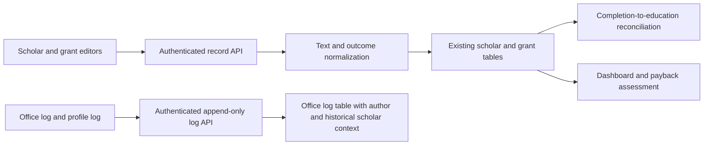

# User findings implementation plan — 12 October 2026

Target: Cathedra FSDP 0.5.17, additive database schema 13. Source request: the owner's `Findings for FSDP.txt`. The owner confirmed uppercase record text with unchanged credentials, and a separate Open/Closed case status so each grant can keep its own Completed/Payback outcome.

## Delivery and acceptance

| # | Requested change | Implementation and acceptance |
|---|---|---|
| 1 | Capital-letter entries | Uppercase editable scholar/program/education/requirement details, remarks and office-log text in the editor and API write path. Keep account credentials, system metadata and canonical enum values unchanged; historical program identities are not bulk renamed or merged. |
| 2 | Education from completed programs | A Completed outcome adds that program to education, even without remarks or a date. Use an explicit graduation date for its year when available; preserve manual year edits/clears and suppressed education. Never infer a graduation year from contract dates or academic terms. |
| 3 | Grant field order | Put period/date details before remarks, followed immediately by grant outcome and the separate case selector, avoiding a return to earlier fields. |
| 4 | Academic-year dash | Normalize an eight-digit consecutive year pair or a recognized range to `YYYY-YYYY`; complete a single four-digit year on blur/save. Retain incomplete/custom text rather than introducing strict validation. |
| 5 | Graduation date | Add an optional date to each grant and display it in its history. Older updates omitting the field preserve the stored value; explicit clearing remains possible. |
| 6 | Icon actions | Use accessible icon-only profile, education-row and grant-row actions with descriptive labels, tooltips and visible focus. Keep primary Save/Cancel controls readable. |
| 7 | Payback status | Keep the explicit Payback outcome available and distinguish it from calculated payback review and the Open/Closed case state. |
| 8 | Age/tenure wheel changes | Prevent focused numeric input changes from mouse-wheel scrolling while preserving typing and keyboard controls. |
| 9 | Duplicate dates empty | Clear actual start/end, contract-completion and graduation dates in a copied grant; reset its case/outcome to Open/On Going and retain annual-period advancement. Preserve the original grant. |
| 10 | Collapsible grant history | Collapse the entire profile grant section with keyboard-accessible disclosure. Expand it for printing and restore its previous state afterward. |
| 11 | Completed and case status | Canonical Completed replaces Graduated; accept old API inputs and migrate existing outcomes without changing IDs. Case Open/Closed is independent per grant; closing a case never silently clears Payback. Retain old aggregate keys as compatibility aliases. |
| 12 | General office logging | Add an append-only office log for notes, submitted documents and transfers, available globally and in scholar profiles. Record the authenticated author, entry date and optional scholar/document/department context. Keep automatic audit history separate and admin-only. |

## Design and data flow

Add optional `graduation_date` and independent `case_status` to grant records, plus one office-log table. Prepare additive columns before older migration code loads current ORM models. Keep IDs, program identities, education edit intent, suppressed achievements, accounts, history, backups and Summer records intact. Only Name and Program Applied remain essential business fields; a log note is required only to avoid creating an empty office-log entry.

The manual log has authenticated read access and the existing admin/staff write boundary. Its server-recorded author cannot be supplied by the client. Entries have no edit/delete endpoint; a later correction is another entry. A deleted scholar leaves historical log context intact. Automatic activity permissions and record-save revision/idempotency behavior stay unchanged.

Retaining legacy aggregate keys reduces upgrade risk for existing report/export consumers while the displayed outcome becomes Completed. Uppercasing new text avoids rewriting historical evidence or equivalent program names. Append-only logs provide traceability at the cost of requiring explicit correction notes. Revisit document attachments, log retention and richer workflow states only if office usage later requires them.

## Test plan

- Backend API/integration: uppercase write values, account credentials unchanged, legacy outcome compatibility, same-program Completed education/payback, explicit date year, manual/suppressed education, omitted-versus-cleared dates/case fields, duplicate dates and source immutability.
- Migration/recovery: copied older schemas upgrade through 13 without ORM-column errors; preserve existing record/account IDs, Summer and education intent; protected snapshot/rehearsal/rollback remain functional.
- Office-log API: anonymous/viewer/admin/staff boundaries, server author attribution, pagination/filtering, Unicode uppercase, immutable entries, retained context after scholar deletion, safe CSV output and atomic audit creation.
- Frontend interactions: year formatting without rejecting partial text, field sequence, optional date/case controls, wheel and keyboard behavior, accessible icon actions, disclosure/print restoration, office-log save/error/navigation handling and existing report-print scope guards.
- Delivery: final backend/frontend suites, Ruff, application/test TypeScript, production build, documentation/export contracts, final frozen manifest and synthetic packaged update. Use disposable synthetic data throughout testing.

## Rollout

Build in the existing isolated workspace using pinned dependencies. Install a tested development runtime only while the app is closed, after a protected snapshot, preserving the working database and source. Publish an application-only Office update and its instructions. E: and the actual Office PC are outside this implementation. Actual Office-PC startup, native printing and assistive-technology acceptance remain separate.

Implementation and local verification completed on 13 October 2026. See [0.5.17 validation](../VALIDATION_0.5.17.md) for the final regression, package, synthetic upgrade, browser acceptance and database-preserving development installation results. Office delivery and intended-device acceptance are recorded separately there.
